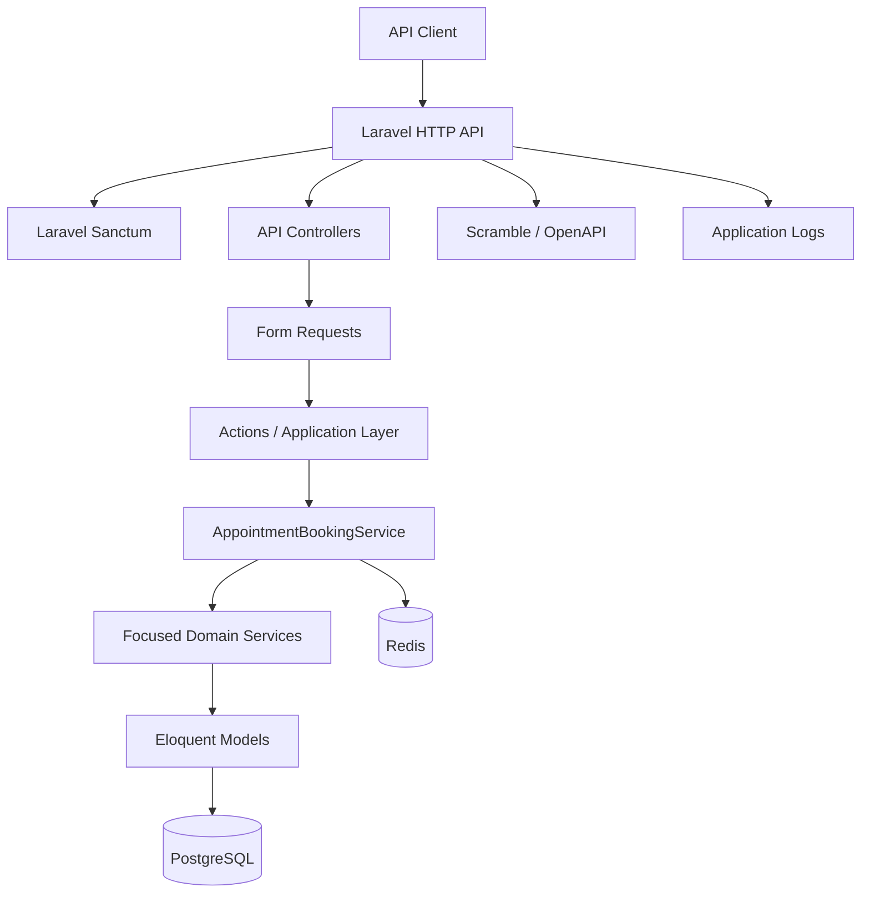
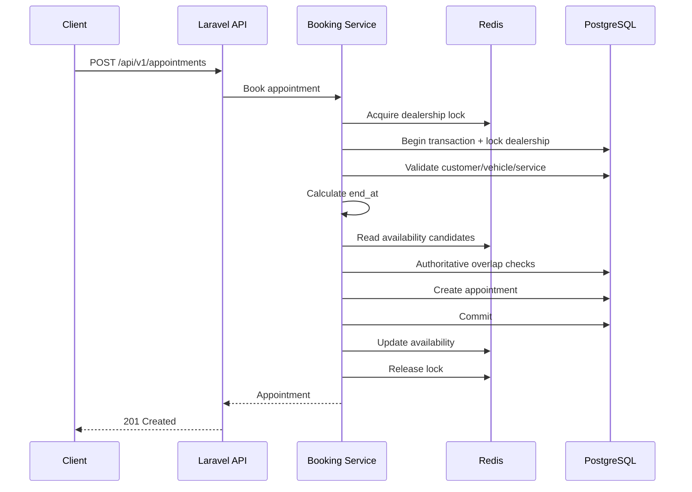
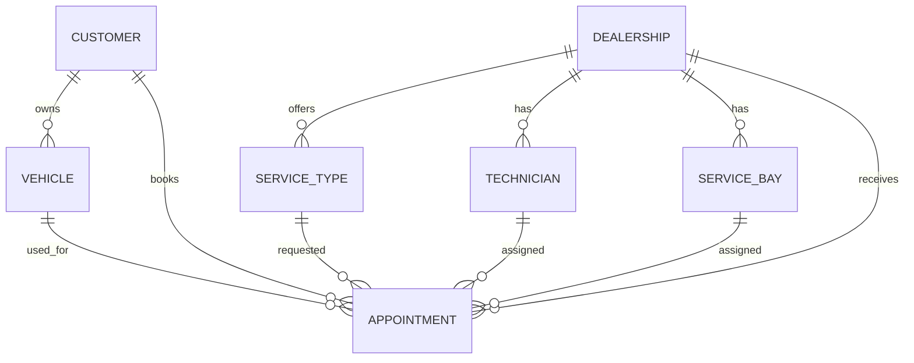

# Keyloop MVP — System Design

## 1. Purpose and Scope

Keyloop is a Laravel API for managing customer vehicle service appointments.

The MVP covers customer authentication, vehicle ownership, dealership service configuration, service types with independent duration, technician/service-bay assignment, appointment lifecycle, and concurrent booking protection.

PostgreSQL is the authoritative transactional store. Redis provides booking coordination and availability acceleration.

## 2. Architecture



Booking flow:



## 3. Component Responsibilities

| Component | Responsibility |
|---|---|
| Controllers | HTTP boundary; keep request/response handling thin. |
| Form Requests | Input validation. |
| Actions | Application use-case orchestration. |
| AppointmentBookingService | Booking transaction, locking, validation, resource selection, persistence. |
| Customer/Dealership/ServiceType services | Focused domain operations. |
| Technician/ServiceBay services | Resource selection and validation. |
| AppointmentService | Appointment queries/lifecycle. |
| RedisBookingLockService | Dealership-level booking coordination. |
| Redis availability services | Fast availability/candidate lookup. |
| Eloquent | Persistence mapping and relationships. |
| PostgreSQL | Authoritative transactional state. |
| Redis | Coordination/cache; never final authority. |
| Sanctum | API authentication. |
| Scramble | OpenAPI documentation. |
| Docker Compose | Repeatable local infrastructure. |

## 4. Domain Model



`ServiceType` is independent from Technician and ServiceBay.

For the MVP:
- Dealership owns/offers service types.
- ServiceType owns duration.
- Technicians and service bays are available resources.
- No qualification/capability matrix is required.

## 5. Booking Data Flow

1. Customer authenticates with Sanctum.
2. Client sends booking request.
3. Form Request validates input.
4. Authenticated customer is used as owner.
5. Redis dealership booking lock is acquired.
6. PostgreSQL transaction starts.
7. Dealership row is locked.
8. Customer, vehicle, dealership and service type are validated.
9. ServiceType duration determines `end_at`.
10. Redis provides fast availability candidates.
11. PostgreSQL performs authoritative overlap checks.
12. Technician and service bay are selected deterministically.
13. Appointment is created.
14. Transaction commits.
15. Redis indexes are updated.
16. Lock is released.
17. API returns the appointment.

Failure rolls back the database transaction and releases coordination state.

## 6. Concurrency and Consistency

Appointments use half-open intervals:

```text
[start_at, end_at)
```

Overlap rule:

```text
existing.start_at < requested.end_at
AND
existing.end_at > requested.start_at
```

Redis helps coordinate. PostgreSQL decides.

Resource selection considers only active resources belonging to the requested dealership and excludes resources with overlapping confirmed appointments.

## 7. Authentication and Authorization

Laravel Sanctum protects authenticated API operations.

Customer identity comes from the authenticated user, not an arbitrary client-supplied `customer_id`.

Customers must only access their own vehicles and appointments.

## 8. API Surface

| Method | Endpoint | Purpose |
|---|---|---|
| POST | `/api/v1/auth/login` | Customer login. |
| POST | `/api/v1/appointments` | Create appointment. |
| GET | `/api/v1/appointments` | List customer's appointments. |
| GET | `/api/v1/appointments/{appointment}` | View appointment. |
| POST | `/api/v1/appointments/{appointment}/cancel` | Cancel appointment. |
| GET | `/api/v1/health` | Health check, where enabled. |

Swagger/OpenAPI:

```text
http://localhost:9000/docs/api
```

## 9. Technology Choices

| Technology | Reason |
|---|---|
| PHP 8.5 | Project runtime. |
| Laravel 13 | Mature API/application framework. |
| Sanctum | Simple API token authentication. |
| PostgreSQL | Strong transactions and row locking. |
| Redis | Low-latency coordination and availability support. |
| Eloquent | Native Laravel persistence/relationships. |
| Dedoc Scramble | OpenAPI documentation. |
| Pest 4 / PHPUnit 12 | Automated testing. |
| Docker Compose | Reproducible local environment. |
| UUID | Non-sequential public identifiers. |
| Composer | PHP dependency management. |

## 10. Scalability

Laravel instances can scale horizontally behind a load balancer:

```text
Load Balancer
      |
+-----+-----+-----+
|           |     |
Laravel 1 Laravel 2 Laravel N
+-----+-----+-----+
      |
 +----+----+
 |         |
PostgreSQL Redis
```

Keep application instances stateless. Scale PostgreSQL and Redis independently and introduce queues for non-critical asynchronous work.

## 11. Performance

- Use Redis for fast availability assistance.
- Keep database transactions short.
- Lock only required rows.
- Query only relevant resources.
- Maintain appropriate database indexes.
- Avoid N+1 queries.
- Use deterministic resource selection.
- Move non-critical work to queues when appropriate.
- Measure before adding complexity.

Correctness is prioritized over optimistic shortcuts.

## 12. Reliability

- PostgreSQL transactions protect persistence.
- Database locking protects authoritative booking decisions.
- Redis is not authoritative.
- Failed transactions roll back.
- Booking locks are released.
- Validation happens before deeper business logic.
- Resource conflicts are explicit API conflicts.

Production should add backups, restoration tests, monitoring, timeouts, rate limiting and rollback procedures.

## 13. Maintainability

```text
Controller
    ↓
Form Request
    ↓
Action
    ↓
Application / Domain Service
    ↓
Eloquent Model
    ↓
PostgreSQL
```

This keeps controllers small, business rules testable, and responsibilities focused.

## 14. Observability

### Logging

Useful booking events:

```text
booking.redis_unavailable
booking.redis_index_failed
booking.redis_lock_release_failed
booking.resource_unavailable
booking.transaction_failed
```

Never log passwords, tokens, database credentials or sensitive payloads.

### Metrics

Track:
- HTTP request/error rate and latency.
- Booking success/failure/conflict counts.
- Booking transaction duration.
- PostgreSQL latency/connections.
- Redis latency/errors/lock failures.
- Queue depth and failures.

### Tracing

OpenTelemetry-compatible tracing can model:

```text
HTTP request
  └── appointment booking
        ├── Redis lock
        ├── DB transaction
        ├── resource queries
        ├── appointment insert
        └── Redis update
```

## 15. GenAI-Assisted Design

GenAI was used as an engineering assistant to:
1. Inspect repository structure, source, migrations, routes, tests and Docker configuration.
2. Identify business invariants.
3. Reason about concurrent bookings and resource overlap.
4. Compare Redis and database locking strategies.
5. Design the layered application structure.
6. Review failure and rollback paths.
7. Convert design decisions into implementation/testing tasks.
8. Investigate test failures.
9. Produce and refine documentation.

GenAI was not treated as the source of truth. Final decisions were validated against source code, schema, tests, framework behavior and runtime configuration.

## 16. Architectural Decisions

- Layered Laravel architecture with thin controllers.
- `ServiceType` owns service duration.
- PostgreSQL is authoritative.
- Redis is advisory/coordination.
- Dealership-level booking lock plus database row lock.
- Half-open appointment intervals.
- UUID identifiers.
- Sanctum authentication.
- Docker Compose infrastructure.
- Scramble API documentation.
- Pest/PHPUnit testing.
- GenAI-assisted engineering with source/tests remaining authoritative.
